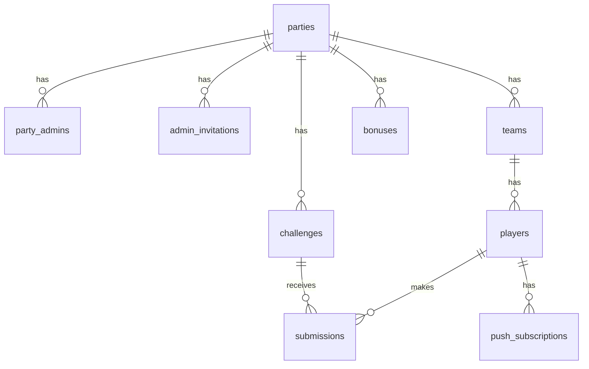

# Keranemie — Architecture

See [start.md](start.md) for the functional spec.

## Tech stack

| Concern | Choice | Why |
|---|---|---|
| Framework | **Next.js 16** (App Router, TypeScript), Cache Components off | One codebase for player app, admin app and API (Server Actions / Route Handlers). Every page depends on the user, so there is no static shell to cache |
| Database | **Supabase Postgres** | Relational data, views for scores, constraints |
| Local development | **Supabase CLI** (`supabase start`, runs in Docker, ports 553xx, Edge Functions off) | Database, auth, storage and real-time locally |
| ORM / migrations | **Drizzle** | Typed schema in TS, SQL migrations in the repo |
| Admin auth | **Supabase Auth**, email magic link | No passwords; the same email is used for admin invitations |
| Player auth | **Supabase anonymous sign-in** | Players get a real user id without an account; the session lives on the device |
| Photo storage | **Supabase Storage** (private bucket, signed URLs) | Same provider, access tied to auth |
| Real-time | **Supabase Realtime** (broadcast channel per party) | Dashboard, leaderboard and feed update live |
| Scheduled jobs | **pg_cron** + **pg_net** (Postgres extensions in Supabase) | Every minute, calls the app to send flash challenge notifications |
| Push notifications | **Web Push** (`web-push`, VAPID keys) + service worker | Works in the browser and the installed PWA |
| UI | **Tailwind CSS** + **shadcn/ui** | Fast, accessible mobile UI |
| i18n | **next-intl** (fr, en), no locale in URLs | Locale from a cookie set by the in-app switch, else the device language. Dates use the device time zone, stored in a cookie by the browser |
| Tests | **Vitest** (game rules), **Playwright** (end-to-end flows against local Supabase) | |
| Image resize | `browser-image-compression` (client side, max 1600px, JPEG) | Smaller uploads on mobile networks |
| QR code | `qrcode` | Join link → QR, shown full screen |

Supabase covers database, auth, storage and real-time in one service. That keeps the setup small for ~50 players per party.

Hosting and deployment are out of scope for now.

### Principles

- **All writes go through the server** (Server Actions), which check that the caller is an admin of the party or a player in it. Clients never write to tables directly.
- **Real-time is a signal, not data**: after a write, the server broadcasts a small event (`submission.created`, `submission.reviewed`, `challenge.updated`, …) on the public `party:{id}` channel. Clients refetch what they display, grouping bursts of events into one refresh. Events carry no content (at most a player id and a review status), so the channel being public only reveals that something happened. Tables are never exposed through Realtime.
- **Game rules are pure functions** in `src/lib/game/` (status, availability, validation, team assignment, notification timing), unit-tested and shared by the server and the UI.
- **Time-based state is computed, not stored**: party status and flash challenge availability are derived from timestamps. No job is needed to "start" or "end" something. A job is only used to send push notifications.

## Data model

### `parties`

| Column | Type | Notes |
|---|---|---|
| id | uuid PK | |
| name | text | |
| description | text null | |
| join_code | text unique | 6 chars, no ambiguous characters (0/O, 1/I) |
| starts_at | timestamptz | Scheduled start. "Start now" sets it to `now()` |
| ends_at | timestamptz | Scheduled end. "End now" sets it to `now()` |
| opened_at | timestamptz null | Null = draft. "Open" sets it to `now()` |
| created_by | uuid → auth.users | Owner |
| created_at | timestamptz | |

Derived status:
- `opened_at` is null → **draft**
- `now() < starts_at` → **open**
- `now() < ends_at` → **live**
- otherwise → **ended**

### `party_admins`

| Column | Type | Notes |
|---|---|---|
| party_id | uuid → parties | PK (party_id, user_id) |
| user_id | uuid → auth.users | |
| role | enum `owner` \| `admin` | Only the owner removes admins or deletes the party |
| created_at | timestamptz | |

### `admin_invitations`

| Column | Type | Notes |
|---|---|---|
| id | uuid PK | |
| party_id | uuid → parties | |
| email | text | |
| token | text unique | Sent in the invitation link |
| invited_by | uuid → auth.users | |
| expires_at | timestamptz | 7 days |
| accepted_at | timestamptz null | |

### `teams`

| Column | Type | Notes |
|---|---|---|
| id | uuid PK | |
| party_id | uuid → parties | |
| name | text | Unique per party |
| color | text | Hex, from a fixed palette |
| emoji | text null | |
| position | int | Display order |

### `players`

| Column | Type | Notes |
|---|---|---|
| id | uuid PK | |
| party_id | uuid → parties | |
| team_id | uuid → teams | Assigned on join to the smallest team (random tie-break), in a transaction |
| user_id | uuid → auth.users | Anonymous Supabase user; unique per party |
| display_name | text | Unique per party, case-insensitive (`unique (party_id, lower(display_name))`) |
| created_at | timestamptz | |

### `challenges`

| Column | Type | Notes |
|---|---|---|
| id | uuid PK | |
| party_id | uuid → parties | |
| title | text | |
| description | text | |
| type | enum `photo` \| `text` | |
| points | int | Default points, copied to the submission on approval |
| validation | enum `auto` \| `manual` | |
| expected_answer | text null | Text type only |
| kind | enum `permanent` \| `flash` | |
| flash_starts_at | timestamptz null | Flash only. "Launch now" sets it to `now()` |
| flash_duration_min | int null | Flash only |
| start_notified_at | timestamptz null | Flash only. Set when the start notification is sent; reset when `flash_starts_at` changes |
| position | int | Display order |
| hidden | boolean | |
| created_at | timestamptz | |

A challenge is **available** when the party is live, it isn't hidden, and (for flash ones) `flash_starts_at <= now() < flash_starts_at + duration`.

### `submissions`

| Column | Type | Notes |
|---|---|---|
| id | uuid PK | |
| party_id | uuid → parties | Denormalized for feeds and filtering |
| challenge_id | uuid → challenges | |
| player_id | uuid → players | |
| status | enum `pending` \| `approved` \| `rejected` | |
| text_answer | text null | Text type |
| photo_path | text null | Storage path, photo type |
| caption | text null | Photo type |
| points_awarded | int null | Set on approval: challenge points, adjustable by the admin |
| review_message | text null | Shown to the player on rejection |
| reviewed_by | uuid null → auth.users | Null for automatic validation |
| reviewed_at | timestamptz null | |
| created_at | timestamptz | |

Constraint: one non-rejected submission per player and challenge, so a player can retry after a rejection:
`unique (challenge_id, player_id) where status <> 'rejected'`

Automatic validation:
- Photo, or text without an expected answer → **approved** immediately.
- Text with an expected answer → compared after normalization (lowercase, accents removed, trimmed). Match → **approved**; no match → **rejected** with a "wrong answer" message, and the player can try again.

### `bonuses`

| Column | Type | Notes |
|---|---|---|
| id | uuid PK | |
| party_id | uuid → parties | |
| player_id | uuid null → players | Exactly one of player_id / team_id is set |
| team_id | uuid null → teams | |
| points | int | Negative to remove points |
| reason | text | |
| created_by | uuid → auth.users | |
| created_at | timestamptz | |

### `push_subscriptions`

| Column | Type | Notes |
|---|---|---|
| id | uuid PK | |
| player_id | uuid → players | |
| endpoint | text unique | |
| p256dh | text | |
| auth | text | |
| locale | text | Language of the notifications for this device |
| created_at | timestamptz | |

A device has one subscription: when it joins another party, the subscription moves to the new player.

### Scores (SQL views)

- `player_scores`: per player, sum of `points_awarded` of approved submissions + sum of player bonuses.
- `team_scores`: per team, sum of its **current** players' scores + sum of team bonuses. Because scores are computed from the player's current team, a player's points move with them when they change team.

For ~50 players, computing these on each read is fast enough; no cached totals needed.

## Background work

- **Flash challenge notification**: a pg_cron job runs every minute and calls `POST /api/jobs/flash-notifications` through pg_net, authenticated with a shared secret header (`CRON_SECRET`). The extensions are enabled by a migration; the job itself is scheduled per environment, because it needs the app URL and the secret (locally in `supabase/seed.sql`). The handler picks the flash challenges that have started, aren't hidden, belong to a live party and have `start_notified_at` null. For each, it sets `start_notified_at`, sends web push to all players of the party, and broadcasts `challenge.started`. Setting `start_notified_at` first makes the job safe to run twice. Notifications can be up to a minute late.
- **"Launch now"**: the Server Action sends the notification directly instead of waiting for the job.
- **Review notification**: sent directly from the review Server Action (web push + broadcast). Later point changes are not pushed.
- **Pages refresh themselves** at the next scheduled change (party start or end, flash challenge start or end), so availability is right even without an event.

## Routes

| Path | Who | Content |
|---|---|---|
| `/` | everyone | Enter a join code (returning players go to their party); link to admin sign-in |
| `/join/[code]` | player | Party info, display name, confirm |
| `/p/[partyId]` | player | Waiting screen before the start; then time left, scores, challenges to do and done |
| `/p/[partyId]/challenges/[challengeId]` | player | Challenge detail and submission form |
| `/p/[partyId]/leaderboard` | player | Teams and players ranking |
| `/p/[partyId]/feed` | player | Approved submissions |
| `/admin/login` | admin | Magic link sign-in |
| `/auth/confirm` | admin | Magic link landing; accepts pending invitations |
| `/admin` | admin | My parties |
| `/admin/new` | admin | Create a party |
| `/admin/[partyId]` | admin | Live dashboard: counts, rankings, flash challenges, activity, move players, bonus points |
| `/admin/[partyId]/review` | admin | Review queue, recently reviewed |
| `/admin/[partyId]/challenges` (`/new`, `/[challengeId]`) | admin | Challenges: list, create, edit, hide, reorder, launch now |
| `/admin/[partyId]/teams` | admin | Teams |
| `/admin/[partyId]/gallery` | admin | Photo gallery, filters by team and challenge |
| `/admin/[partyId]/settings` | admin | Party details, lifecycle, admins and invitations, deletion |
| `/admin/[partyId]/share` | admin | Code, link and QR code, full screen |
| `/invite/[token]` | admin | Accept an admin invitation |
| `POST /api/jobs/flash-notifications` | scheduler | Announce flash challenges that started |
